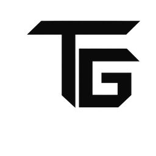

  <picture>
    <source media="(prefers-color-scheme: dark)" srcset="assets/logo-light.png">
    
  </picture>

<h2 align="center">Тимур Галиев</h2>

Full-stack разработчик · Python · Go · TypeScript · React · Docker

<a href="https://pro-risk.github.io">Портфолио со скриншотами проектов →</a>

---

Привет! Мне 24, я full-stack разработчик. Пишу бэкенд на Python и Go, интерфейсы на React и TypeScript, сам упаковываю проекты в Docker, настраиваю серверы, CI/CD и деплой.

- Сейчас веду CRM для сервисного бизнеса: Django + React + Go, два продакшена — Казахстан и Кыргызстан.
- Делаю свои продукты: цифровую визитку [QazQR](https://qaz-qr.kz) и дерево казахских родов «Шежіре».
- Для души делаю игры на Godot.

### Стек

**Языки**

**Бэкенд**

**Фронтенд**

**Данные**

**DevOps**

**Десктоп и геймдев**

### Проекты

| Проект | Что это | Стек |
| --- | --- | --- |
| **TENNET CRM** | CRM для клиник и салонов: запись, касса, зарплата, склад, мессенджеры с AI-агентом. 2 884 моих коммита, около 590 тыс. строк | Django, React, Go, PostgreSQL, Celery |
| **[QazQR](https://qaz-qr.kz)** | Цифровая визитка с тамгой рода и QR-меню для заведений | React, Django, PWA, Redis |
| **Шежіре** | Дерево казахских родов на 3,4 млн узлов, ответ API 2–9 мс | Python, FastAPI, PostgreSQL, React |
| **Bitlo** | Перенёс работающий сервис с облачной платформы на собственный сервер в Docker | PostgreSQL, Deno, Redis, nginx |
| **CowoFlo** | AI-помощник флориста и MCP-сервер на 86 инструментов | TypeScript, MCP, Anthropic SDK |
| **MC Panel** | Панель для Minecraft-серверов и лаунчер для друзей | Go, PostgreSQL, React, Docker |
| **Адская Смена** | Ретро-шутер: кампания, рогалик, кооператив до 8 игроков через Steam | Godot, GDScript |
| **Asset Forge** | Инструмент для игровых ассетов: обработка спрайтов, анимация, тайлы и карты | TypeScript, Fastify, Docker |
| **Porthole** | Игра по LAN через интернет: проброс порта друзьям через сеть Steam | Rust, Tauri |
| **Tarkov Wiki** | Офлайн-справочник и компаньон для Escape from Tarkov | Tauri, Rust, React |

Код большинства проектов закрыт — покажу на созвоне.
